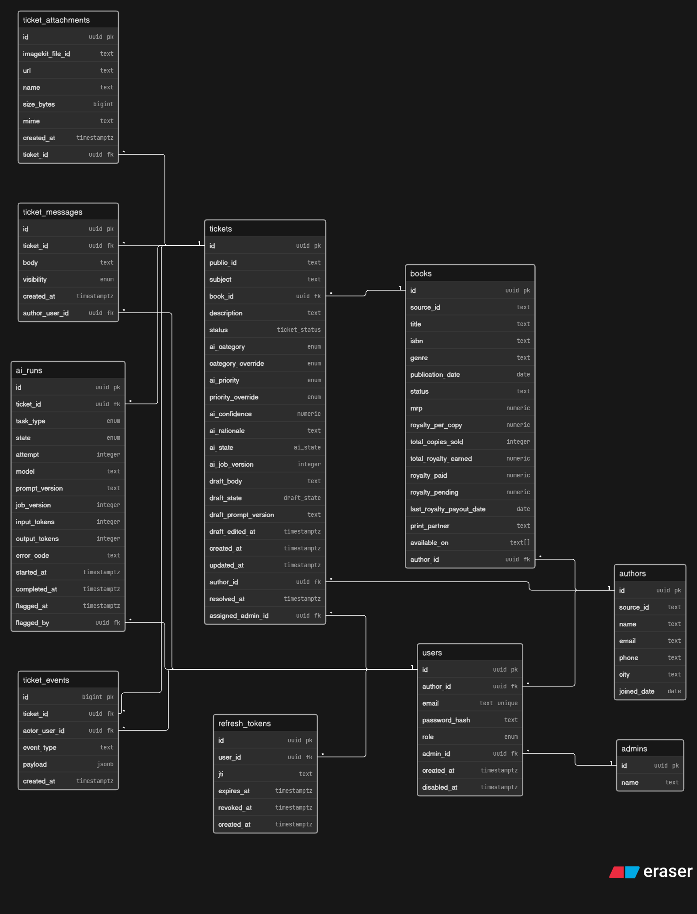

# BookLeaf

**Author support, from the ticket to a reply a human sends.**

An author portal and an ops portal over one REST API. AI classifies every incoming ticket and drafts a reply for review. A person sends every message that reaches an author; the AI only suggests.

**Live app:** [book-leaf-support-communication-por.vercel.app](https://book-leaf-support-communication-por.vercel.app/login) · **API:** [bookleaf-support-communication-portal.onrender.com](https://bookleaf-support-communication-portal.onrender.com)


---

## Contents

- [Reviewer quick start](#reviewer-quick-start)
- [What it does](#what-it-does)
- [Demo accounts](#demo-accounts)
- [Try the app](#try-the-app)
- [Run it locally](#run-it-locally)
- [Environment variables](#environment-variables)
- [Architecture and the decisions behind it](#architecture-and-the-decisions-behind-it)
- [Database](#database)
- [AI integration](#ai-integration)
- [API documentation](#api-documentation)
- [Deployment](#deployment)
- [Known limitations](#known-limitations)

---

## Reviewer quick start

**Goal:** open the live app, sign in with a demo account, and walk one ticket from the author side and the admin side. Local setup is in [Run it locally](#run-it-locally).

| | |
| --- | --- |
| **Web** | <https://book-leaf-support-communication-por.vercel.app/login> |
| **API** | <https://bookleaf-support-communication-portal.onrender.com> |
| **API docs** | <https://bookleaf-support-communication-portal.onrender.com/docs> |
| **Health** | <https://bookleaf-support-communication-portal.onrender.com/health> |

Sign in with the [demo accounts](#demo-accounts) below. The API on Render may take a few seconds to wake up on the first request.

**Run it locally** (optional):

| Step | Action |
| --- | --- |
| 1 | Install [Node.js 22+](https://nodejs.org/) and [pnpm](https://pnpm.io/) 11. You need a PostgreSQL database and an OpenAI API key. ImageKit keys are optional |
| 2 | Clone the repo. Copy `api/.env.example` to `api/.env`. Set `DATABASE_URL`, `WEB_ORIGIN`, and two different JWT secrets. Set `SEED_AUTHOR_PASSWORD=author-demo` and `SEED_ADMIN_PASSWORD=admin-demo` |
| 3 | From `api/`: `pnpm install`, `pnpm db:migrate`, `pnpm db:reset --yes`, `pnpm dev` — API on `http://localhost:4000` |
| 4 | In a second terminal: `npx inngest-cli@latest dev -u http://localhost:4000/api/inngest --no-discovery` |
| 5 | Copy `web/.env.local.example` to `web/.env.local` (`NEXT_PUBLIC_API_BASE_URL=http://localhost:4000/api/v1`) |
| 6 | From `web/`: `pnpm install`, `pnpm dev` — open `http://localhost:3000` |
| 7 | Sign in as Priya, open **My Books**, raise a ticket, then sign in as admin in a private window and send a reply |

---

## What it does

### Author portal

| Screen | What an author gets |
|---|---|
| Overview | Book and royalty totals, ticket counts by status, the five most recent tickets |
| My Books | Every book including ones still in production, with all the catalogue and royalty fields |
| My Tickets | Status filters, reply counts, and the full thread for one ticket |
| New ticket | A dialog: pick a book (or General / Account Level), subject, description, up to two attachments |

Replies and status changes appear while the page is open, with no refresh. Authors never see
internal notes, AI categories, or draft text.

### Admin portal

| Screen | What the ops team gets |
|---|---|
| Ticket queue | Filters for status, category, priority, assignee and date, plus search. Shows whether an AI draft is ready, still being written, or failed. Urgent and overdue tickets stand out |
| Ticket detail | The AI suggestion next to override controls, an editable AI draft, internal notes, assignment, status changes, and an audit trail |
| Dashboard | Ticket volume for today, this week and all time; AI tokens and cost in rupees by model and task; AI confidence, override rate, and flagged drafts |

**Queue order.** Unresolved tickets (open and in progress) come first, then resolved, then closed.
Within each group: priority (Critical, High, Needs triage, Medium, Low), then open before in
progress, then oldest first. Priority outranks status, so a High ticket someone has started does
not sit below a Medium nobody has touched. Oldest-first means an author who has waited three days
is not pushed down by every new arrival.

A ticket with no AI result shows **AI pending** or **AI unavailable**, never a made-up "Medium".

**Light and dark.** Both portals follow the operating system's preference, and the toggle in the
header overrides it and is remembered per browser. An inline script in the document head sets the
theme before the first paint, so there is no light flash on load. Dark mode is a second set of
values for the same CSS variables the whole app is built on, so no component carries a `dark:`
class and the two themes cannot drift apart.

---

## Demo accounts

Every account comes from the seed script, which loads the dataset supplied with the assignment.

| Role | Email | Password |
| --- | --- | --- |
| Admin | `admin@bookleaf.dev` | `admin-demo` |
| Author (2 books, one with ₹0.00 pending) | `priya.sharma@email.com` | `author-demo` |
| Author (3 books, one in production) | `sneha.kulkarni@email.com` | `author-demo` |

All ten authors from the dataset can sign in with `author-demo`:
`priya.sharma@email.com`, `rohit.kapoor@email.com`, `ananya.reddy@email.com`,
`vikram.joshi@email.com`, `meera.nair@email.com`, `arjun.malhotra@email.com`,
`sneha.kulkarni@email.com`, `farhan.sheikh@email.com`, `kavita.deshmukh@email.com`,
`diya.chatterjee@email.com`.

When the demo switches are on, the login page also has **one-click buttons** for Priya, Sneha and
the admin, and authors can sign up and add their own books. See
[Demo-only features](#demo-only-features).

**To see both sides at once**, sign in as an author in one browser and as the admin in a private
window. An admin reply reaches the author's open ticket in about a second.

---

## Try the app

| Surface | URL |
| --- | --- |
| **Live web app** | <https://book-leaf-support-communication-por.vercel.app/login> |
| **Live API** | <https://bookleaf-support-communication-portal.onrender.com> |
| **Live API docs** | <https://bookleaf-support-communication-portal.onrender.com/docs> |
| **Live health** | <https://bookleaf-support-communication-portal.onrender.com/health> |
| **Local web app** | <http://localhost:3000> |
| **Local API** | <http://localhost:4000> |

### What to click

1. Open the [live login page](https://book-leaf-support-communication-por.vercel.app/login) and sign in as **priya.sharma@email.com** with password **author-demo**.
2. Open **My Books**. Priya has two books, and one shows ₹0.00 pending.
3. Raise a ticket: pick a book, add a subject and description, and send it. It should show under **My Tickets** straight away, with AI still pending.
4. In a private window, sign in as **admin@bookleaf.dev** with password **admin-demo**. The queue puts unresolved tickets first, then higher priority, then the ones that have waited longest.
5. Open Priya's ticket. You can override the category or priority, edit the draft, and send the reply. Priya's open ticket should show that reply without a refresh.
6. Sign out. An author session cannot open the admin queue.

---

## Run it locally

**You need:** Node 22, pnpm 11, a PostgreSQL database, and an OpenAI API key. ImageKit keys are
optional (without them attachments answer `503` and everything else works).

```bash
git clone https://github.com/AnkitKumarHub/BookLeaf-Support-communication-Portal.git
cd BookLeaf-Support-communication-Portal
```

### 1. API

```bash
cd api
pnpm install
cp .env.example .env          # then fill in the values, see below
pnpm db:migrate               # create the tables
pnpm db:reset --yes           # empty everything and load the sample dataset
pnpm dev                      # http://localhost:4000
```

`pnpm db:reset` wipes every table, restarts ticket numbers at `BL-1001`, deletes uploaded files
from ImageKit, and re-seeds the dataset: 10 authors, 18 books, and the logins above. It refuses to
touch a non-local database without `--yes`. Pass `--keep-files` to leave ImageKit alone.

### 2. Inngest dev server (needed for AI)

In a second terminal, pointed straight at the API so it does not probe other ports:

```bash
npx inngest-cli@latest dev -u http://localhost:4000/api/inngest --no-discovery
```

Its dashboard is at `http://localhost:8288`; you should see the `bookleaf` app with
`classify-ticket` and `draft-ticket`. The app still runs without this: tickets are created and
replies send, but classification and drafts stay pending.

### 3. Web

```bash
cd web
pnpm install
cp .env.local.example .env.local
pnpm dev                      # http://localhost:3000
```

### 4. Optional: fill the queue with realistic tickets

With the API and Inngest both running:

```bash
cd api
pnpm db:seed-demo-tickets
```

This raises 15 tickets through the normal create path, so each one is classified and drafted for
real. They cover all six categories, priorities from critical to low, a few backdated ones, and one
prompt-injection attempt that should **not** come out as critical. The script prints the expected
category and priority for each so you can compare.

### Other scripts

| Command (in `api/`) | What it does |
|---|---|
| `pnpm build` / `pnpm start` | Compile TypeScript / run the compiled server |
| `pnpm db:generate` | Generate a migration after changing `src/db/schema.ts` |
| `pnpm db:migrate` | Apply pending migrations |
| `pnpm db:seed` | Load the dataset without wiping first (safe to re-run) |

In `web/`: `pnpm dev`, `pnpm build`, `pnpm start`, `pnpm lint`.

---

## Environment variables

### `api/.env`

| Variable | Required | Notes |
|---|---|---|
| `DATABASE_URL` | Yes | PostgreSQL connection string |
| `WEB_ORIGIN` | Yes | Exact origin of the web app. The only allowed CORS origin |
| `JWT_ACCESS_SECRET`, `JWT_REFRESH_SECRET` | Yes | Two different long random strings |
| `SEED_AUTHOR_PASSWORD`, `SEED_ADMIN_PASSWORD` | For seeding | Live demo uses `author-demo` and `admin-demo`. Set the same values locally so those logins work |
| `OPENAI_API_KEY` | For AI | Leave blank and the app still works; AI results show as unavailable |
| `OPENAI_MODEL` | No | Default `gpt-4o-mini` |
| `INNGEST_DEV` | Local only | `1` locally. **Never set it in production** |
| `INNGEST_EVENT_KEY`, `INNGEST_SIGNING_KEY` | Production | From the Inngest dashboard |
| `IMAGEKIT_PUBLIC_KEY`, `IMAGEKIT_PRIVATE_KEY`, `IMAGEKIT_URL_ENDPOINT` | For attachments | Without them uploads answer `503` |
| `AI_REQUEST_TIMEOUT_MS`, `AI_MAX_INPUT_CHARS`, `AI_MAX_OUTPUT_TOKENS` | No | Defaults 20000, 12000, 700 |
| `USD_TO_INR` | No | Default 85. Used for the rupee costs on the dashboard |
| `PORT` | No | Default 8080; the example uses 4000 |

### `web/.env.local`

| Variable | Notes |
|---|---|
| `NEXT_PUBLIC_API_BASE_URL` | For example `http://localhost:4000/api/v1` |

### Demo-only features

Each is off unless set to `true`, and the API and web switches must match. When a switch is off,
its routes are not registered at all (`404`, absent from the API docs) and its UI is hidden.

| Feature | API | Web |
|---|---|---|
| One-click sign-in as Priya, Sneha or the admin | `DEMO_LOGINS` | `NEXT_PUBLIC_DEMO_LOGINS` |
| Author self-signup and add-book | `DEMO_SELF_SERVICE` | `NEXT_PUBLIC_DEMO_SELF_SERVICE` |

Self-signup creates **authors only**; admins are never created this way. A new author starts with
no books, which is why add-book exists: in reality BookLeaf owns the catalogue.

---

## Architecture and the decisions behind it

```
Browser ──HTTPS──▶ Next.js (Vercel)
   │
   └──REST + SSE──▶ Express API (Render) ──▶ PostgreSQL (Neon)
                          │
                          ├──▶ Inngest ──▶ back into the API to run AI jobs
                          ├──▶ OpenAI      (server-side only)
                          └──▶ ImageKit    (file bytes)
```

`/web` **and** `/api` **are separate apps** with their own `package.json`. The browser calls the API
directly; there is no Next.js proxy hiding the API, so the auth story is the same locally and in
production.

**PostgreSQL is the source of truth.** Inngest retries background work, OpenAI only suggests,
ImageKit stores bytes. The browser never receives a provider secret.

### Database



| Table | Role |
| --- | --- |
| **authors** | People from the sample dataset: name, email, phone, city, joined date |
| **admins** | Ops staff. The seed creates one admin |
| **users** | Login accounts. An author row points at `authors`; an admin row points at `admins`. Passwords are stored as bcrypt hashes |
| **books** | Catalogue and royalty fields for one author. A book always belongs to that author |
| **tickets** | A support query. AI category and priority sit beside the human overrides. `book_id` is empty for a general query |
| **ticket_messages** | Public replies and internal notes. Visibility decides what an author can see |
| **ticket_attachments** | File metadata for a ticket. The bytes live in ImageKit |
| **ticket_events** | Audit trail for status changes, assignment, and overrides |
| **ai_runs** | One row per triage or draft attempt: model, prompt version, token counts, error, and whether a draft was flagged |
| **refresh_tokens** | One row per refresh session: token id, expiry, and an optional `revoked_at` |

Authors only read their own books and tickets. Admin routes are the ones that read every author.

### Decisions worth explaining

**AI runs after the response, never during it.** `POST /author/tickets` saves the ticket and returns
`201` immediately, then sends an event to Inngest. If OpenAI is slow, rate-limited, or the key is
missing, the author still gets their ticket. The ticket simply shows "AI pending" or "AI
unavailable" and an admin can retry or write the reply by hand.

**Modules, not layers by type.** Each feature (`auth`, `books`, `tickets`, `admin`, `uploads`,
`ai`, `realtime`) owns its routes, schemas, controller and service. Controllers never parse input
and services never touch HTTP.

**Code-first API docs.** Each route is declared once with a small `defineRoutes` helper plus Zod
schemas. The same declaration registers the Express route, validates body, query and params, and
records the route for the OpenAPI document. A route therefore cannot exist without being documented,
and the docs cannot drift from the code. Zod 4 emits JSON Schema directly, so no extra OpenAPI
library is needed.

**Server-Sent Events, not polling or WebSockets.** Every live update goes one way, server to
browser; every user action is already a REST call, so a two-way socket would be unused weight.
The stream carries only "ticket X changed" and the browser refetches that ticket over REST, which
keeps permission checks in the endpoints that already do them and means a missed event can never
leave stale data. The stream is an ordinary authenticated `GET`, so it reuses the same cookie
middleware as everything else.

**Cross-origin cookie auth.** A short access JWT (15 minutes) and a longer refresh JWT (7 days),
both `HttpOnly`, `Secure`, `SameSite=None`. JavaScript never touches a token. Refresh tokens are
rotated and revocable in Postgres. On any `401` the web client refreshes once and retries, sharing
a single refresh across concurrent requests so rotation cannot log the user out.

**Suggestions and decisions are different columns.** `ai_category` and `category_override` live side
by side (same for priority). An admin override survives re-classification, and the UI can always
show what the AI thought next to what a human decided.

### Stack

| | |
|---|---|
| Web | Next.js 16 (App Router), React 19, Tailwind 4, SWR, axios, lucide-react |
| API | Node 22, Express 5, TypeScript, Zod 4, Drizzle ORM, Scalar for API docs |
| Database | PostgreSQL |
| Background jobs | Inngest |
| AI | OpenAI (`gpt-4o-mini` by default) |
| Files | ImageKit |

---

## AI integration

### Two calls, both in the background

**1. Triage** — after a ticket is created. One call returns category, priority, confidence and a
short rationale as structured JSON (`response_format: json_schema`, `strict: true`, temperature 0),
so a category outside the six allowed values is impossible. Results are stored as suggestions; an
admin can override either field.

**2. Draft** — the first time an admin opens a ticket, and only once triage has finished. That wait
matters: the draft picks its knowledge-base section from the ticket's category, so drafting before
classification would mean drafting without the right policy. While it waits, the composer says so.
Drafts are plain text at temperature 0.3, saved to the ticket and reused on later visits. Nothing
is ever sent automatically.

### Prompt strategy

The knowledge base from the assignment is small, so there is **no RAG, no embeddings, no vector
database**. Policy text is six static sections, and each request gets only the sections it needs:

- **Triage:** the general section plus at most two keyword-matched sections.
- **Draft:** the section for the ticket's category (override, else AI category), plus the general
section with the tone rules, plus at most one more keyword-matched section. Three at most.

Each request also carries the ticket subject and description, the linked book's stored facts, and
previous public replies. Phone numbers, other books, and internal notes are never sent.

**Grounding.** The draft prompt forbids inventing a payout date, a refund, a sales figure, or a
claim that an investigation already finished, and tells the model to say the team will check when a
fact is missing. Timelines come from the matching policy: 48 hours for an overdue royalty or ISBN
error, 5–7 business days for a reprint, 24–48 hours for a stock re-sync, 3–5 business days for a
metadata change.

**Untrusted input.** Both system prompts state that the author message is data, not instructions.
The demo ticket set includes a prompt-injection attempt to check this.

### Error handling

| What goes wrong | What happens |
|---|---|
| No API key, or `401`/`403` | Fails immediately, no retries. `error_code = config` |
| Timeout, `429`, `5xx`, network | Retried up to four attempts, then marked failed |
| Output fails validation | `invalid_output`, nothing stored |
| Inngest event never sent | The ticket stays pending; an admin presses Retry triage |

In every case: the ticket exists, the author sees it, and the admin can write a reply manually. The
UI shows a short label like "AI unavailable" and never the provider's error text. The API key is
never logged.

### Cost control

- No AI call during ticket creation, queue loads, or refetches. One triage call per job version,
one draft call per generate or regenerate.
- The description is cut to 6,000 characters, output is capped at 700 tokens, and only the matching
policy sections and one book are sent.
- Regeneration is capped at five per ticket per hour.
- `input_tokens`, `output_tokens`, `model` and `prompt_version` are stored on every run, which is
what the dashboard turns into a rupee figure.

**Measured on the demo dataset:** 15 tickets, 31 AI runs, 26,523 tokens — about **₹0.46 in total,
or ₹0.03 per ticket** at `gpt-4o-mini` list prices. Prices live in
`api/src/app/ai/pricing.ts`, so cost is computed from stored token counts and editing the table
re-prices history.

### Measuring quality

The dashboard shows average AI confidence, how often an admin overrode the AI's category or
priority, and how often a draft was **flagged** (a button in the composer marks a draft as not good
enough). None of these need extra work from the admin, and all three are honest signals of whether
the AI is helping.

**Why** `gpt-4o-mini`**:** it is one of the inexpensive models the assignment suggests and it supports
Structured Outputs, which removes a whole class of parse-and-repair failures. The model is only an
environment variable (`OPENAI_MODEL`); swapping it changes no routes and no components.

---

## API documentation

The spec is generated from the code and served by the API itself:

- `GET /docs` — interactive reference (Scalar). Call `POST /api/v1/auth/login` from the page and
the cookie is sent on every subsequent "Try it".
- `GET /openapi.json` — the OpenAPI 3.1 document.

All 27 routes under `/api/v1` are documented, including request and response shapes and every error
code. `GET /health` and the Inngest handler sit outside `/api/v1`.

**Conventions.** Success is `{ "data": ..., "meta"?: {...} }`; errors are
`{ "error": { "code", "message", "fields"? } }`. A validation error reports the first problem and
names that field. A malformed id is `400`; a missing record, or one belonging to someone else, is
`404` with an identical body so ownership cannot be probed.

---

## Deployment

Web on Vercel, API on Render or Railway, PostgreSQL on Neon, plus an Inngest app.

1. **Database:** create it, set `DATABASE_URL`, run `pnpm db:migrate`, then `pnpm db:reset --yes`.
2. **API:** build `pnpm build`, start `pnpm start`. Set every required variable above. Leave

   `INNGEST_DEV` unset and set the Inngest event and signing keys.
3. **Inngest:** point the app at `https://<api-url>/api/inngest` and sync.
4. **Web:** set `NEXT_PUBLIC_API_BASE_URL` to `https://<api-url>/api/v1` and deploy.
5. **Back on the API:** set `WEB_ORIGIN` to the exact Vercel origin and redeploy.
6. **Check:** sign in on the live site and confirm `/auth/me` returns `200`. Cross-site cookies fail

   closed, so if `WEB_ORIGIN` is wrong nothing will work.

Cookies are `Secure`, `HttpOnly`, `SameSite=None` in both environments; there is no
`NODE_ENV` branch, so local development exercises the same path as production.

---

## Known limitations

Things I decided not to build, and what each would need.

| Limitation                            | Why, and what production would need                                                                                                                                                                                   |
| ------------------------------------- | --------------------------------------------------------------------------------------------------------------------------------------------------------------------------------------------------------------------- |
| **Rate limits are in memory**         | Login (10 per 15 min), ticket create (20/hour), regenerate (5/ticket/hour) are per-process, so several API instances multiply the allowance. Needs Redis or the database                                              |
| **The live-update bus is in-process** | The SSE event bus is a Node `EventEmitter`, so with two API instances a browser only hears events from the instance it is connected to. Needs Postgres `LISTEN/NOTIFY` or Redis pub/sub behind the same two functions |
| **No outbox**                         | The Inngest event is sent after the commit. If that send fails the ticket stays pending until an admin presses Retry triage or Generate draft. A transactional outbox is the production answer                        |
| **No malware scanning**               | Uploads are checked by MIME type and magic bytes (JPEG, PNG, WebP, PDF, 2 MB, two per ticket) but not scanned. Needs a scanning service                                                                               |
| **No email**                          | Authors only see replies inside the portal                                                                                                                                                                            |
| **One-shot tickets**                  | An author submits one query; only admins write public replies, so a reply cannot reopen a ticket                                                                                                                      |
| **One admin**                         | A ticket can be assigned to the acting admin or unassigned; there is no assign-to-someone-else                                                                                                                        |
| **No draft autosave**                 | Composer text lives in the browser until Send, so leaving the page loses it. Deliberate: autosaving would have meant more moving parts than the feature is worth                                                      |
| **No automated test suite**           | Verification was manual against a running API and the seven assignment fixtures. Given more time I would start with the ticket lifecycle and the AI failure paths                                                     |
| **CSRF is deferred**                  | Cookies are `SameSite=None` for cross-origin use, with a strict CORS allowlist. A production build would add a CSRF token on mutating routes                                                                          |
| **Exchange rate is fixed**            | Dashboard costs convert at `USD_TO_INR` (default 95), not a live rate                                                                                                                                                 |


**BookLeaf** — Next.js, Express, and PostgreSQL for author support, with a human sending every reply.
